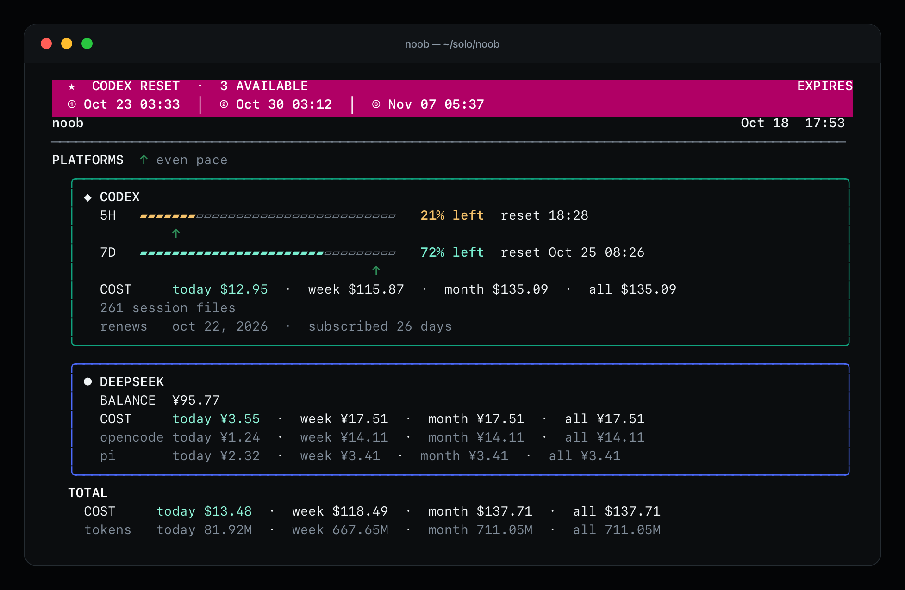
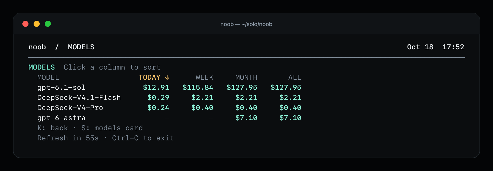
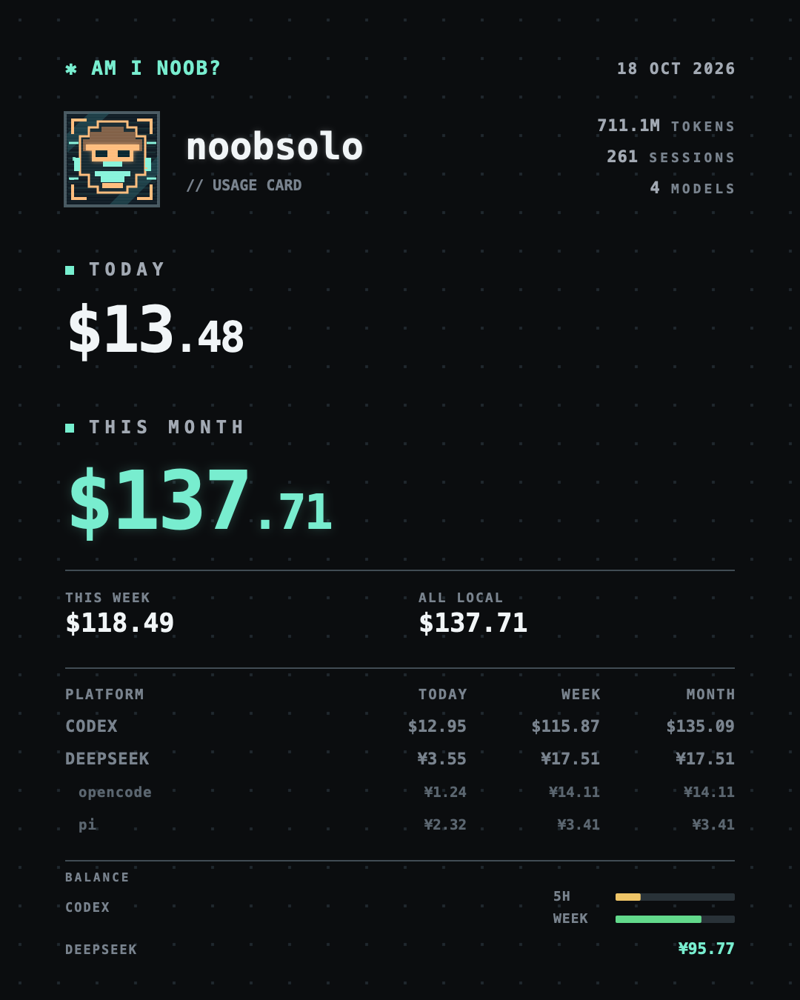
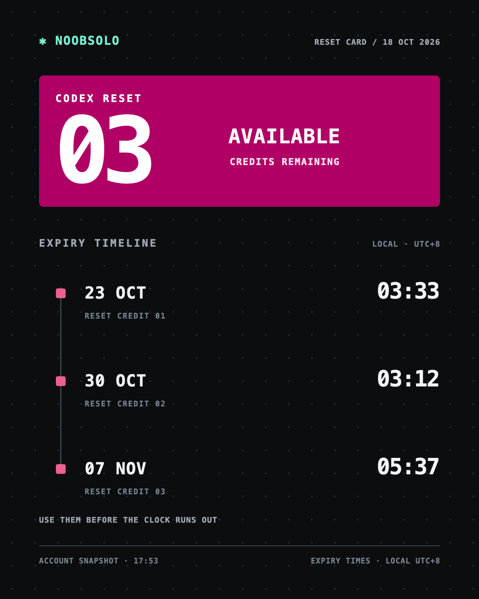
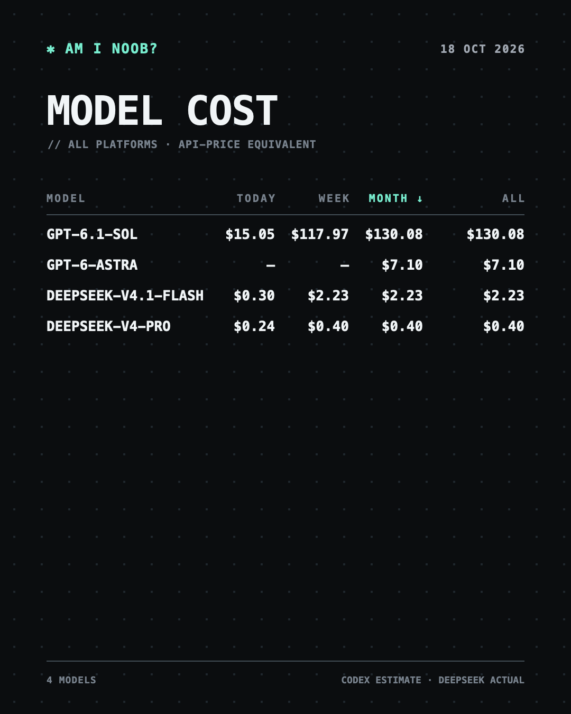

# noob

A terminal dashboard for your Codex and DeepSeek usage — quota bars, spend by model, reset credits, and shareable cards, without leaving the shell.



## What it shows

- Codex 5H / WEEK quota bars (remaining %)
- Cost per model: today, week, month, all (press `k`)
- Token totals: today, week, month, all
- Rate-limit reset credits and their expiry
- DeepSeek balance (optional)

Per-model breakdown with `k`:



## Cards

Press `s` to save a usage card, `m` for reset credits, or open the models view with `k` and press `s` for the model-cost card. All are written to `~/Downloads` as PNGs.

<p align="center">
  <a href="assets/card-usage.png"></a>
  &nbsp;&nbsp;
  <a href="assets/card-reset.png"></a>
</p>
<p align="center"><sub>Usage card with <code>s</code> · reset-credit card with <code>m</code></sub></p>

<p align="center">
  <a href="assets/models-card.png"></a>
</p>
<p align="center"><sub>Model cost card with <code>k</code> → <code>s</code></sub></p>

## Requirements

- macOS
- `codex` CLI, logged in with `codex login`
- Python 3 (no extra packages). Compressed Codex rollouts (`*.jsonl.zst`) need
  Python 3.14+, the `zstandard` package, or the `zstd` command; without one of
  them those older sessions are skipped.

## Run

```sh
noob          # dashboard, refreshes every 60s
noob --once   # print one snapshot and exit
```

Keys:

| Key | Action |
| --- | --- |
| `s` | Save a card for the current view (usage, or model costs in the models view) |
| `m` | Save a reset-credit card PNG |
| `k` | Toggle the models view |
| `Ctrl-C` | Quit |

## Nightly cards

Capture the home usage card and the models detail card every night at midnight,
into `~/Downloads/noob-daily/`:

```sh
noob --install-daily          # every night at 00:00
noob --install-daily 23:50    # or another time
noob --uninstall-daily        # remove the schedule
noob --daily-cards            # capture right now
```

Files are named `noobsolo-usage-YYYYMMDD.png` and `noobsolo-models-YYYYMMDD.png`,
so re-running on the same day replaces that day's pair instead of piling up
duplicates. Pass `--daily-dir DIR` (on its own or together with
`--install-daily`) to archive somewhere other than Downloads.
A dashboard left open across midnight captures on its own too.

The schedule is a launchd agent at `~/Library/LaunchAgents/com.noob.dailycards.plist`;
its output goes to `~/Library/Logs/noob-daily.log`. If the Mac is asleep at
midnight, launchd runs the capture once it wakes.

## Optional

DeepSeek balance — store the key once in the macOS Keychain:

```sh
security add-generic-password -s noob-deepseek -a "$USER" -w
```

Or set `DEEPSEEK_API_KEY` in your shell. The env var wins.

OpenAI API bill — set `OPENAI_ADMIN_KEY`, then run `noob --api`.

## Where the numbers come from

- Codex quota: the Codex app-server
- Codex usage: `~/.codex/sessions` logs
- Prices: OpenAI's pricing page (cached in `pricing_cache.json`)
- DeepSeek usage: local `opencode` and `pi` logs, priced with DeepSeek's CNY table
- Renewal date: `subscription_info.json`

Costs are API-price equivalents for your tokens, not what you were actually billed.

## Files

- `noob.py` — main dashboard
- `noob_pricing.py` — price tables
- `noob_card.py` — usage card
- `noob_reset_card.py` — reset card
- `subscription_info.json` — renewal date

## Sources

- https://learn.chatgpt.com/docs/app-server
- https://developers.openai.com/api/docs/pricing
- https://api-docs.deepseek.com/quick_start/pricing
